<p align="center">
  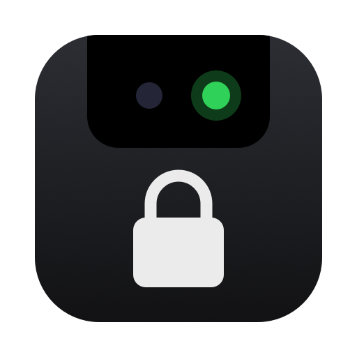
</p>

<h1 align="center">Rualock</h1>

<p align="center">
  Locks your Mac the moment you walk away.<br>
  On-device face recognition, with a tiny status light that grows out of the camera notch.
</p>

<p align="center">
  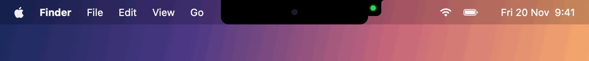
</p>

Rualock watches your webcam for *your* face. When your face has been gone for a few seconds (8 by default), it locks the screen, just like pressing ⌃⌘Q. While you're at the Mac, a green dot sits right next to the camera, as if the notch had grown a status light. Everything runs on the Mac: no account, no network, no images saved.

## Features

- **Recognises you, not just any face.** Someone else sitting down doesn't keep your Mac unlocked.
- **A photo isn't enough.** A face that appears after a gap has to blink or talk before it counts as you, and a photo or a frozen screen does neither. Once your face is confirmed (by a blink, by talking, or by being there right after you unlock), it stays confirmed for as long as it's continuously in view. If the camera loses you for a moment (looking down makes detection flicker) and finds you again within 6 seconds, within about two face widths of where you were, you stay confirmed.
- **Typing counts.** Looking down at the keyboard can hide your face from the camera. Keyboard and mouse use that carries straight on from your confirmed face, with no pause over 3 seconds, keeps you present for up to 90 seconds. Right after you unlock or click Resume, typing counts straight away. Someone sitting down after you leave can't pick it up, because standing up and sitting down takes longer than that.
- **Lives in the notch.** A black shape extends the camera housing, so it looks like part of the hardware. Hover over it to read the status; it opens and closes on a spring.
- **Or just the menu bar.** A normal menu bar icon shows the same dot and countdown ring, and its menu has pause, lock, Settings and Quit. In Settings you can turn off the light next to the camera, the menu bar icon, or neither; at least one stays on. Settings has styles for the light (Compact, Standard, Large, Notch height) and, under Advanced, sliders for its height, dot, text, corner radius, and how it flares into the top of the screen and the side of the notch.
- **Prank mode: freeze instead of lock.** In Settings, set "When you leave" to *Freeze the screen*. Instead of locking, Rualock covers the screen with an invisible window: everything looks unlocked, but clicks, typing, ⌘-Tab and Force Quit do nothing. It lifts when Rualock sees your face again (blink to confirm, so a photo won't do), or when the Mac is locked and unlocked (⌃⌘Q, the Touch ID button or closing the lid, then your password). While frozen, the dot turns red. If the camera stops working while frozen, Rualock locks for real. Switching it on needs Touch ID. It's a prank, not a lock: Mission Control, Spotlight and other system shortcuts still get through.
- **Visible countdown.** When you leave, an amber ring drains around the dot, then the Mac locks.
- **Pause with Touch ID.** Click the dot to pause for 15 minutes; a grey ring shows the time left. Locking the screen ends a pause, so protection is back on as soon as you log back in.
- **Hard to switch off by accident or by someone else.** Pausing, quitting and re-enrolling all need Touch ID or your Mac password.
- **Camera off when it isn't needed.** The camera stops while the screen is locked or protection is paused.
- **Fails safe.** If the camera stops working, the Mac doesn't lock you out. The dot turns red instead.
- **Light.** Native Swift and Core ML, about 20 MB, around 10% of one CPU core on an M-series MacBook Air (about 6% with the camera light hidden).

## Screenshots

| | |
|---|---|
| **Walk away:** the ring drains, then the Mac locks | 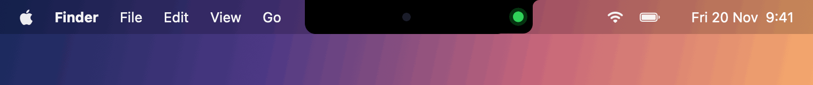 |
| **Hover** while counting down | 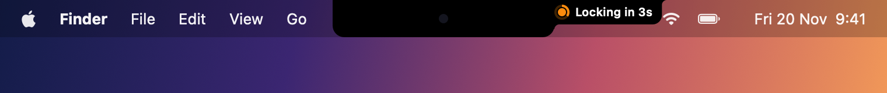 |
| **A face came back:** it must blink first | 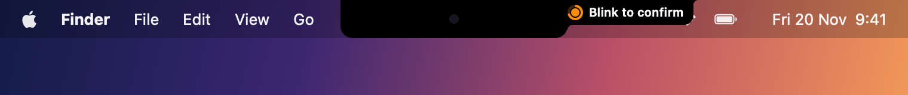 |
| **Paused** for 15 minutes with Touch ID | 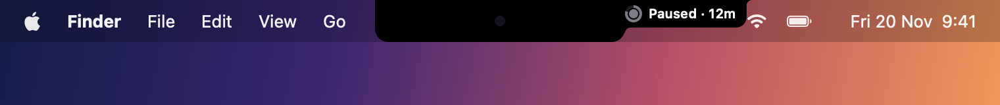 |
| **Camera problem:** the Mac stays unlocked | 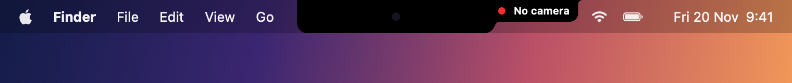 |
| **Menu bar icon** and its menu | 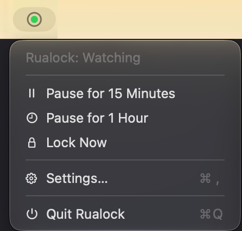 |

<p align="center">
  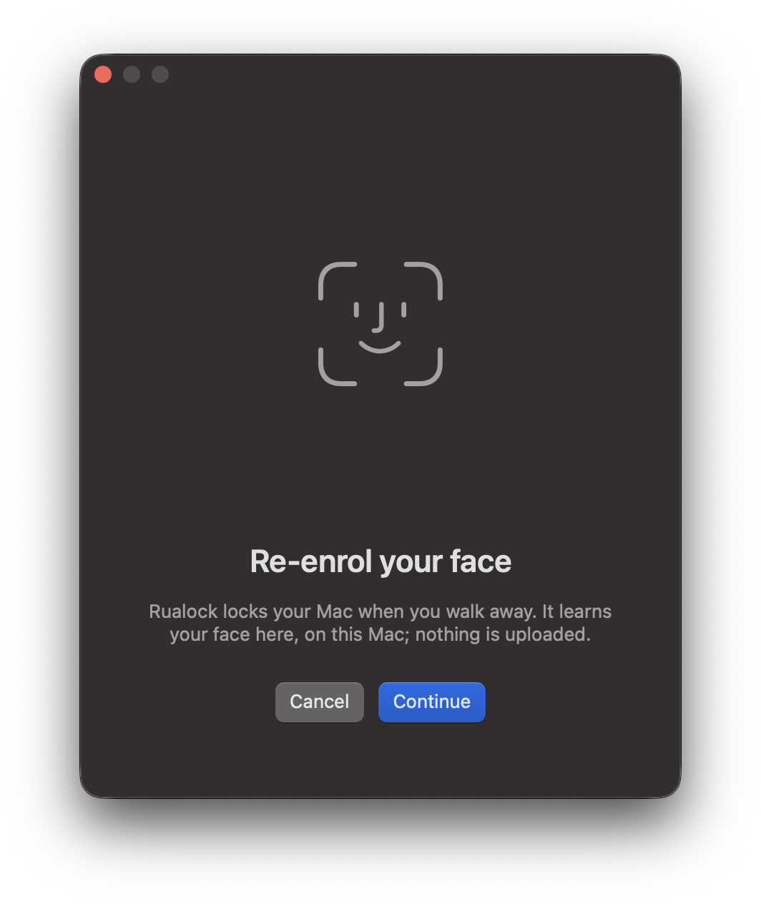
  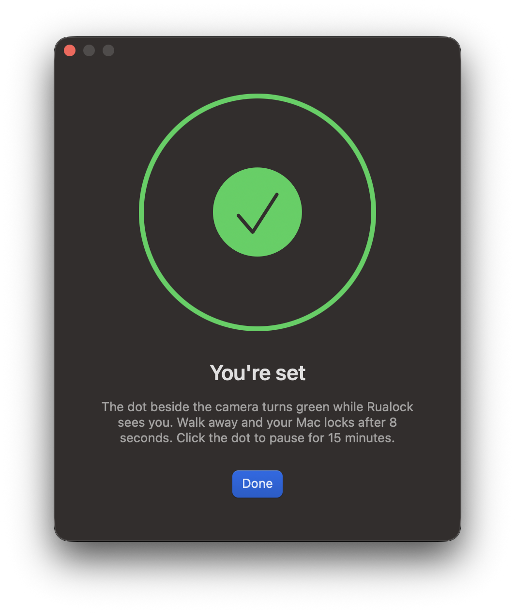
  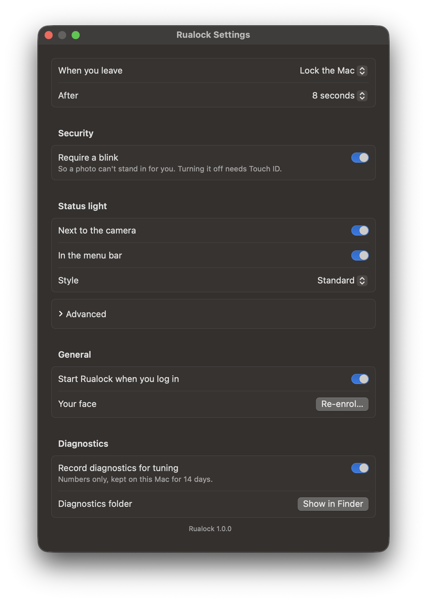
</p>

## How it works

1. The camera runs at about 10 frames per second, and Rualock checks 4 of them each second.
2. Apple's **Vision** framework finds faces and their landmarks: eyes, nose and mouth corners.
3. Each face is aligned to a standard 112×112 pose, then **SFace** turns it into 128 numbers (an *embedding*). SFace is a small face-recognition network from the [OpenCV model zoo](https://github.com/opencv/opencv_zoo/tree/main/models/face_recognition_sface), converted to Core ML.
4. Each embedding is compared with the 30 samples taken during setup. A cosine similarity of 0.363 or more counts as you.
5. **Liveness.** Rualock follows the face from frame to frame. Right after you unlock, the face in front of the camera is trusted, because you've just typed your password or used Touch ID. A face that turns up after a gap (more than a second out of view, or a jump to another spot) has to blink first. For that, Rualock watches eye openness on every frame (10 per second): a blink is a sharp dip that recovers within 0.8 seconds. Slowly narrowed eyes, such as when you look down at the keyboard, don't count. Eye and mouth shapes are measured in the face's own frame: along the eye line, with eye height relative to the eyes-to-mouth distance. So tilting or tipping a photo back can't fake a blink or a word. While waiting, the light shows "Blink to confirm" and the countdown gets 10 extra seconds. Once confirmed, the face stays confirmed until it disappears again, so slipping a phone in after you get up doesn't work.
6. **Short misses.** A confirmed face that stays in place rides out up to 1.5 seconds of failed matches, which happen when you turn or tilt your head. Swapping a face in front of the camera moves it, so this doesn't help a photo.
7. **Typing.** If the camera loses your face but your keyboard and mouse use carries straight on (see Features), the countdown waits. The light shows "Typing".
8. If you haven't been seen for the lock delay, Rualock locks the screen.

On first launch, Rualock asks for camera access and takes about 5 seconds to learn your face. It also adds itself to your login items; you can turn that off in Settings.

To open Settings, use the menu bar icon, right-click the light next to the camera, or open Rualock again from Finder or Spotlight.

## Requirements

- macOS 14 or later, on Apple silicon.
- Xcode 16 or later, to build.
- A notched MacBook for the full look. On other screens, Rualock shows a small pill in the menu bar instead.

## Build and run

```bash
git clone https://github.com/RokaSwK/rualock.git
cd rualock
scripts/build.sh            # → build/Rualock.app
open build/Rualock.app
```

The first build needs [uv](https://docs.astral.sh/uv/). It downloads SFace, checks the download against a pinned SHA-256, and converts the model to Core ML with `coremltools`. This takes a few minutes, and the result is cached in `build/`.

`build.sh` signs the app with the hardened runtime. It uses your Developer ID Application certificate if you have one, otherwise your Apple Development certificate. Override this with `SIGN_IDENTITY=…`, and set `VERSION=…` or `BUNDLE_ID=…` to change those.

### Share a notarized build

With a Developer ID Application certificate and stored notary credentials:

```bash
xcrun notarytool store-credentials rualock --apple-id you@example.com --team-id TEAMID   # once
scripts/build.sh && scripts/notarize.sh     # → build/Rualock-1.0.0.dmg, notarized and stapled
```

### Tests

`swift test` runs the liveness tests: a still photo never passes, someone else's blink doesn't carry over to a photo of you, looking down isn't a blink, and so on.

### Developer tools

| Command | What it does |
|---|---|
| `Rualock.app/Contents/MacOS/Rualock -dryRun YES` | Run without locking; logs "would lock" instead. |
| `Rualock.app/Contents/MacOS/Rualock --embed photo.png` | Print the embedding of the largest face in an image. |
| `Rualock.app/Contents/MacOS/Rualock --screenshots dir` | Render the images in this README. |
| `Rualock.app/Contents/MacOS/Rualock --report [days]` | Summarise the diagnostics: locks by reason and how many were probably false, what happened in the 10 s before each, match scores, eye closures, typing. |

Logs go to `~/Library/Logs/Rualock.log` and to the unified log, under subsystem `com.rualock.mac`.

## Diagnostics

To tune the rules on real use, Rualock records numbers locally, in `~/Library/Application Support/Rualock/Diagnostics`, kept for 14 days. You can turn this off in Settings, and Settings has a "Show in Finder" button for the folder.

- **Samples:** one line per recognition frame, 4 a second while watching: faces seen, match score, eye openness, mouth opening, seconds since your last keyboard or mouse input, state and countdown.
- **Events:** every decision: a new face track and why, how a face was confirmed, tolerated misses, eye closures and their length, typing starting and ending, locks, unlocks, pauses.
- **Locks:** each lock with the 30 seconds before it and how soon you unlocked. Unlocking within 15 seconds marks it as a probable false lock.

There are no images and no face embeddings in these files.

## Privacy

- **Video:** frames are processed in memory and dropped. Nothing is recorded or uploaded, and the app makes no network requests.
- **Face samples:** only the 30 embeddings (numbers, not images) are stored, in `~/Library/Application Support/Rualock/face-embeddings.bin`, readable only by you.
- **Settings and pause state:** UserDefaults, domain `com.rualock.mac`.

## Limitations

- **Not a replacement for your password.** Rualock protects you when you walk away. It doesn't stop a determined attacker: the blink check stops photos, but a video of you blinking could still pass, and Mac webcams have no depth sensor to tell a screen from a face.
- **Uses a private macOS function to lock.** It locks with `SACLockScreenImmediate` from `login.framework`, which is also why it isn't on the Mac App Store. If a future macOS removes the function, Rualock falls back to sleeping the display, which locks only when "Require password immediately" is on.
- **Needs light.** Very dim rooms can make it lose you. Raise the lock delay in Settings if that happens.

## Project layout

```
Sources/Rualock/     the app (Swift, AppKit, Vision, Core ML)
  Watcher.swift        watch-and-lock loop
  FaceEngine.swift     detection, alignment, embeddings
  Island.swift         the notch status light
  EnrollWindow.swift   setup / re-enrol
scripts/             build, notarize, model conversion, icon
Resources/           Info.plist, entitlements
prototype/           the first version, in Python with OpenCV
```

## Credits

- [SFace](https://github.com/opencv/opencv_zoo/tree/main/models/face_recognition_sface) by Yaoyao Zhong et al., from the OpenCV model zoo, Apache License 2.0. See [NOTICE](NOTICE).
- Face detection by Apple's Vision framework.

## License

[MIT](LICENSE)
